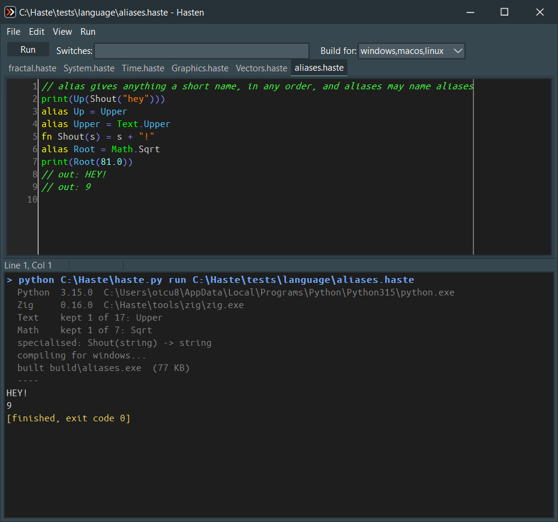

# Hasten, the Haste IDE

A Delphi VCL editor for Haste: tabs, Haste syntax highlighting, Run (F9) and Build (Ctrl+F9) through
`haste.py`, an output panel, and a jump to the line of each compiler error.

Modules and module, type and class aliases are lime; function aliases are sky blue.

## Building

You need Delphi 10.3 or newer (Delphi 13 is fine) and [SynEdit](https://github.com/TurboPack/SynEdit)
(TurboPack, also in GetIt).

1. Run `SynHighlighterHaste.msg` and `SynHighlighterHasteOutput.msg` through SynGen. Each writes its `.pas`
   next to it.
2. Open `Hasten.dpr` in Delphi. Add the SynEdit source folder to the search path if it isn't already.
3. Optional: Project > Options > Application > Icon: `..\assets\haste.ico`.
4. Build. The first Run looks for `haste.py` beside the exe and up to four folders above it (so
   `ide\Win64\Debug\Hasten.exe` finds the repository's `haste.py`), and asks if it can't find it.

## Using it

| Key | Does |
|---|---|
| F9 | Save, then `haste.py run` the current file, with the switch values from Module Options |
| Ctrl+F9 | Save, then `haste.py build` for the targets chosen in Module Options (this system if none) |
| Ctrl+F2 | Stop the running program |
| Project > New Project... | Asks for a name and a folder, and makes `Name/Name.hproj` and `Name/Name.haste` (with `haste.py new`, so the IDE and the command line make the same project) |
| Project > Open Project... (Shift+Ctrl+O), Recent Projects, Close Project | Opening a project closes what was open (asking to save changes) and reopens the files you had open in it. While a project is open, F9 and Ctrl+F9 run and build its program, whichever tab is active |
| Ctrl+Alt+F11 | View > Project Manager: the open project's files at the right, headed by the project and what it builds for (`Fractal - [windows, linux]`), the program first, then its modules and folders of modules. Double-click or Enter opens one. Right-click: Open Project File, New Module..., Rename... (and, if you agree, the files that use the old name are changed to the new one), Delete (to the Recycle Bin), Show in Explorer, Look Again. It follows the folder: files added, saved or removed appear at once |
| Shift+Ctrl+S | Project > Save Project: saves every changed file. Save Project As... renames the project in its own folder, or copies the whole project to another folder and opens the copy |
| Shift+Ctrl+F11 | Project > Options for the open project, saved in its `.hproj` where `haste.py` reads them; with no project, Module Options for the active file, kept in Hasten.ini. Both set what to build for and a value for each switch the program declares (the grid lists them with their defaults; empty means the default) |
| Run > Run Tests | Run the test suite (`tests/run.py`); double-click a `FAIL` line to open that test |
| Ctrl+N / Ctrl+O / Ctrl+S / Ctrl+W | New, open, save, close tab |
| Ctrl+F, F3 | Find, find next |
| Ctrl+G | Go to line |
| View > Font... | Choose the editor font (only monospaced fonts are listed) and size |
| Ctrl+mouse wheel, Ctrl+NumPad + / - / 0 | Make the text bigger, smaller, or back to 11 pt, in every tab |
| Rest the mouse on a name | Help Insight: its declaration, help comment and file:line, and after a Run or Build the types it was compiled with. Works for your own functions, classes, switches and aliases, every library module, the built-ins, list members and keywords. View > Help Insight turns it off |
| View > Toolbar | Show or hide the toolbar: New, Open, Save, Undo, Redo, Cut, Copy, Paste, Find, Run, Build, Stop, Run Tests, Module Options, Settings |
| Tools > Settings... | Font, tab width, right margin, line numbers, VCL style, Python, `haste.py`, clearing the output on each run, reopening last time's files |

A compiler error takes you straight to its line. Double-click any `file.haste:12` in the output to go
there. Settings, each program's module options, the editor font and the files you had open are kept in `%APPDATA%\Hasten\Hasten.ini`.

## Files

| File | |
|---|---|
| `Hasten.dpr` | The program |
| `Hasten.Main.pas` | The main window, built entirely in code (no .dfm) |
| `Hasten.Settings.pas` | The Settings dialog, also built in code; each setting is a property |
| `Hasten.ModuleOptions.pas` | The Module Options dialog: build targets and switch values for one program, read from its source |
| `fmx-test/` | A test of FMXRichMemo as the editor for a cross-platform FMX Hasten; see its README |
| `Hasten.ProjectTree.pas` | The Project Manager: a tree view of the project's folder |
| `Hasten.Insight.pas` | Help Insight: the tips, from the `insight` lines of `haste.py words` and a build's `specialised:` line |
| `Hasten.Highlighter.pas` | The generated highlighter plus built-ins, members and module names from `haste.py words`, so new modules are coloured without regenerating anything |
| `Hasten.Watcher.pas` | Watches `lib` and the program's folder, so a module copied in from outside the IDE is coloured at once |
| `Hasten.Runner.pas` | Runs `haste.py` in the background and streams its output; Stop ends the whole process tree |
| `SynHighlighterHasteOutput.msg` | SynGen description of the output panel's colours: the command, Haste's reports, errors, test results |
| `SynHighlighterHaste.msg` | SynGen description of Haste's syntax; colours designed with [SynEdit Msg Designer](https://groovermd.github.io/SynEditMsgDesigner/) |
